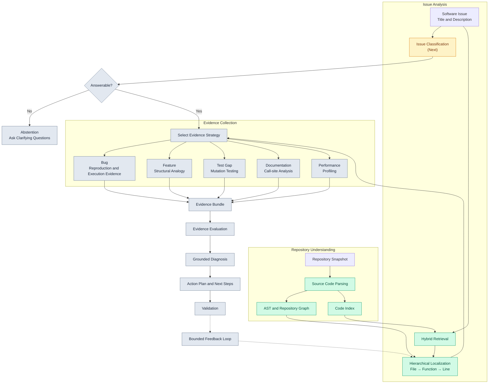

# CodeCompass 🧭

> **Bridging the vocabulary gap between human-described symptoms and code-level mechanisms.**

CodeCompass is a developer tooling and AI engineering system designed to investigate and diagnose software issues. When developers or users report a problem (*"export fails on large invoices"*), they speak in human symptom vocabulary. The codebase, however, operates in structural code vocabulary (`export_batch()`, line 214). CodeCompass automates the journey from symptom to code mechanism using principled information retrieval and empirical execution evidence.

---

## Architecture Overview

CodeCompass is built using **Domain-Driven Design (DDD)**, **Hexagonal/Clean Architecture**, and the **Strategy Pattern**. The core domain logic is decoupled from execution adapters (CLI, FastAPI) and algorithmic strategies.



---

## Current Implementation Status

### ✅ What is Implemented & Working:
1. **Repository Lifecycle & Ingestion:**
   - Clone remote Git repositories to deterministic hashed sandbox locations.
   - Recursive file scanning with automatic pruning of `.git`, `__pycache__`, and virtual environments.
   - Aggregate Root `Repository` with live, immutable `ReadOnlySequence` document views.
   - In-memory `RepositoryManager` for multi-repository persistence.

2. **Code-Aware Tokenization:**
   - Multi-casing sub-token extraction (`snake_case`, `camelCase`, `PascalCase`, numbers).
   - Preserves compound terms as well as constituent parts.
   - Frequency-preserving token streams (no loss of term counts for BM25).

3. **Hierarchical Candidate Generation:**
   - **File-Level Candidates (`FileCandidate`):** Treats whole files as retrieval units.
   - **Function-Level Candidates (`FunctionCandidate`):** Uses Python's native `ast.parse` to extract exact function names, line boundaries (`start_line`, `end_line`), and function-scoped tokens. Fault-tolerant against syntax errors.

4. **Algorithmic Retrieval Engine:**
   - Pure-Python from-scratch **Robertson–Spärck Jones Okapi BM25** (`BM25Scorer`).
   - Implements term-frequency saturation ($k_1$) and document length normalization ($b$).
   - Smoothed non-negative Inverse Document Frequency ($\text{IDF}$).
   - `BM25LocalizationStrategy` ranking candidates with rank and normalized score metadata.

5. **Packaging & CLI Adapter:**
   - Modern PEP 518/621 packaging (`pyproject.toml`).
   - Interactive terminal CLI entrypoint (`run.py` / `codecompass`).

---

## How to Run the Current Project

### 1. Prerequisites
- Python `>= 3.11` (Tested on Python 3.11, 3.12, and 3.13)
- `git` installed on your system path

### 2. Environment Setup
Clone the repository and set up a virtual environment:

```bash
git clone https://github.com/your-username/CodeCompass.git
cd CodeCompass

python3 -m venv .venv
source .venv/bin/activate
```

Install the project in editable mode with development dependencies:

```bash
pip install -e .
pip install -e ".[dev]"
```

### 3. Running the Test Suite
The project includes hermetic unit tests that isolate Git and disk I/O using dynamic mocks and temporary sandboxes:

```bash
# Run all unit and integration tests
PYTHONPATH=src python -m unittest discover tests -v
```

### 4. Running the Interactive CLI
Launch CodeCompass via the entrypoint:

```bash
PYTHONPATH=src python -m code_compass.run
```
*(Or simply type `codecompass` if installed via `pip install -e .`)*

**Workflow:**
1. Enter a Git URL to clone (e.g., `https://github.com/pallets/flask` or any public repo).
2. CodeCompass clones and indexes the repository.
3. Enter an issue description (e.g., *"error during request processing"*).
4. CodeCompass tokenizes the issue, extracts candidate functions/files using AST, scores them with Okapi BM25, and prints the top-ranked code candidates.

---

## Roadmap & Future Modules (Not Yet Implemented)

CodeCompass is designed to progress from baseline retrieval to autonomous issue resolution:

### Phase 1: Classification & Abstention Routing (`application/classification`)
- **Dual Baseline Classifier:** Compare **TF-IDF + Logistic Regression** vs. **Sentence Transformers + Logistic Regression** on historical GitHub issues.
- **Probabilistic Abstention (Regime A vs. B):** If classifier confidence is below a calibrated threshold, abstain from guessing and prompt the user with clarifying questions.
- **Taxonomy:** Probabilistic routing into `{BUG, FEATURE, TEST_GAP, DOCUMENTATION, PERFORMANCE}`.

### Phase 2: Hybrid & Dense Retrieval Spine (A3 & A4)
- **Dense Code Embeddings:** Implement `DenseEmbeddingLocalizationStrategy` using local sentence transformers (`all-MiniLM-L6-v2` or `unixcoder`) on Mac MPS / CUDA.
- **Reciprocal Rank Fusion (RRF):** Combine BM25 lexical ranking and dense vector scores:
  $$\text{RRF\_Score}(d) = \frac{1}{60 + r_{\text{BM25}}(d)} + \frac{1}{60 + r_{\text{Dense}}(d)}$$
- **Call-Graph Structural Centrality:** Build graph models (`networkx`) over AST call sites to compute PageRank centrality boosts for critical execution paths.

### Phase 3: Typed Evidence Pipelines (Phase B)
Instead of speculative LLM code generation, gather empirical evidence at candidate locations:
- **Bug Pipeline:** Automated reproduction test harness; sandbox execution; capturing failing tracebacks and reference execution diffs.
- **Feature Pipeline:** Structural analogy retrieval — locating how similar endpoints/classes are already wired in the codebase.
- **Test Gap Pipeline:** Mutation testing — injecting mutations at localized sites to find surviving mutants.

### Phase 4: Grounded Diagnosis & Guide (Phase C)
- Local LLM diagnosis (Ollama / Llama-3-8B / Groq free-tier) strictly constrained to cite entities present in the evidence bundle (hallucination defense).
- Multi-armed bandit / Thompson Sampling for dynamic cost- and latency-aware model routing.

---

## Project Structure

```text
CodeCompass/
|
├── src/
│   └── code_compass/
│       ├── algorithms/           # Algorithmic cores
|       |   └── classification/       # (Rulebased Baseline, BM25Vectorizer + Logistic Regression)
|       |   └── localization/         # (BM25Scorer, BM25Strategy, Tokenizer)
│       ├── application/          # Use-case services (Localization, RepoInit, etc.)
|       |   └── classification/       # (Classification Service)
|       |   └── localization/         # (Localization Service)
|       |   └── initialization/       # (Initialization Service)
│       ├── domain/               # Core entities (Repository, Document, Candidate, Issue, Token)
|       |   └── candidate_package/    # (Localized Candidates entity)
|       |   └── repository_package/   # (Repository entity)
|       |   └── token_package/        # (Tokens entity)
│       └── pipeline/             # Orchestrator, ServiceCreater, I/O schemas
|       └── logger.py             # Static Logger Object File
|       └── run.py                # CLI - Entry Point 
|
├── tests/
│   └── unitTests/                # Hermetic unit & integration test suites
├── pyproject.toml                # Project metadata & dependency specifications
└── README.md                     # Project documentation
```

---
